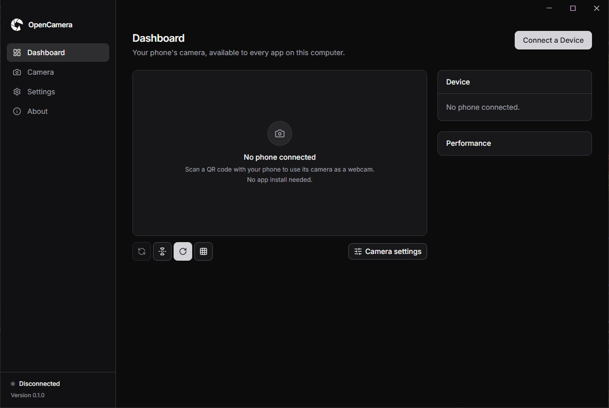
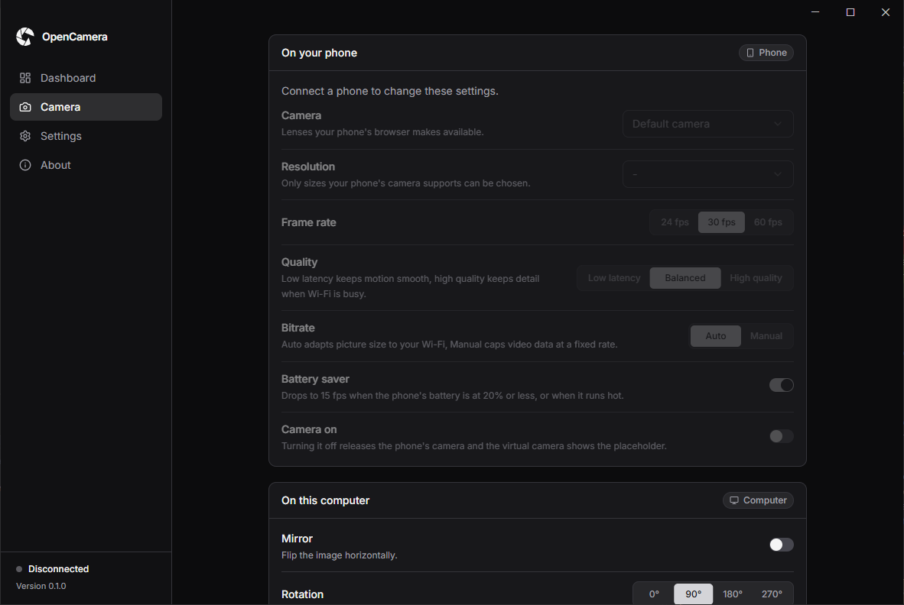
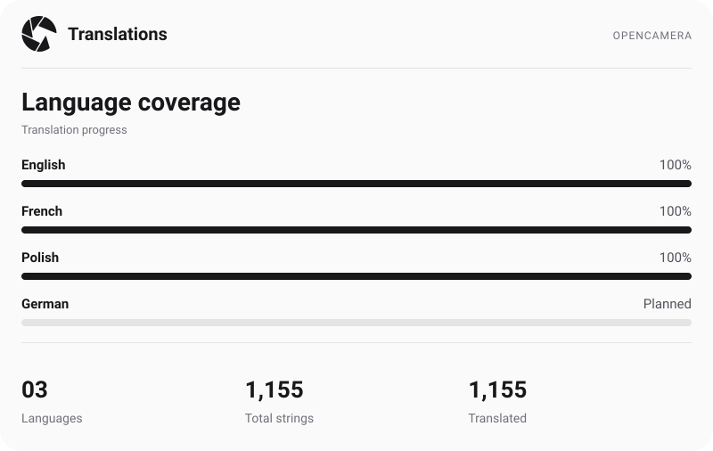

   

OpenCamera turns your phone into a webcam for your computer. The desktop app installs a virtual camera, so video apps like Zoom, Teams, Meet or OBS can use your phone's camera as if it were a regular webcam. The phone's camera stream goes straight to your computer over your local Wi-Fi network, and phones on your network are the only ones that can reach it.

Connecting takes a few seconds and needs no app on the phone. Open OpenCamera on your computer, choose "Connect a Device" and scan the QR code with your phone's camera app. You don't need an app on your phone just a browser.

<table align="center">
  <tr>
    <td align="center" width="50%"></td>
    <td align="center" width="50%"></td>
  </tr>
</table>

## Download

| Platform | Installer | Link |
| --- | --- | --- |
| Windows | `.exe` | [Download](https://github.com/Panonim/opencamera/releases/latest/download/OpenCamera-windows.exe) |
| macOS | `.dmg` | [Download](https://github.com/Panonim/opencamera/releases/latest/download/OpenCamera-macos.dmg) |
| Linux | `.deb` or `.AppImage` | [.deb](https://github.com/Panonim/opencamera/releases/latest/download/OpenCamera-linux.deb) or [.AppImage](https://github.com/Panonim/opencamera/releases/latest/download/OpenCamera-linux.AppImage) |

## Features

- No app on the phone: it streams from the phone's browser after a QR code scan
- Virtual camera driver installed from the app on Windows, macOS and Linux
- Frame rate adapts automatically to phone heat and battery level
- Live stream stats: dropped frames, packet loss and round trip time
- Single-use pairing codes that expire after 5 minutes

 

<picture><source media="(prefers-color-scheme: dark)" srcset="https://www.shieldcn.dev/github/last-commit/panonim/opencamera.svg?variant=secondary&amp;mode=dark"></picture>
<picture><source media="(prefers-color-scheme: dark)" srcset="https://www.shieldcn.dev/github/commits/panonim/opencamera.svg?variant=secondary&amp;mode=dark"></picture> 
<picture><source media="(prefers-color-scheme: dark)" srcset="https://www.shieldcn.dev/github/closed-issues/panonim/opencamera.svg?variant=secondary&amp;mode=dark"></picture>
<picture><source media="(prefers-color-scheme: dark)" srcset="https://www.shieldcn.dev/github/merged-prs/panonim/opencamera.svg?variant=secondary&amp;mode=dark"></picture>
<picture><source media="(prefers-color-scheme: dark)" srcset="https://www.shieldcn.dev/github/license/panonim/opencamera.svg?variant=outline&amp;mode=dark"></picture>

